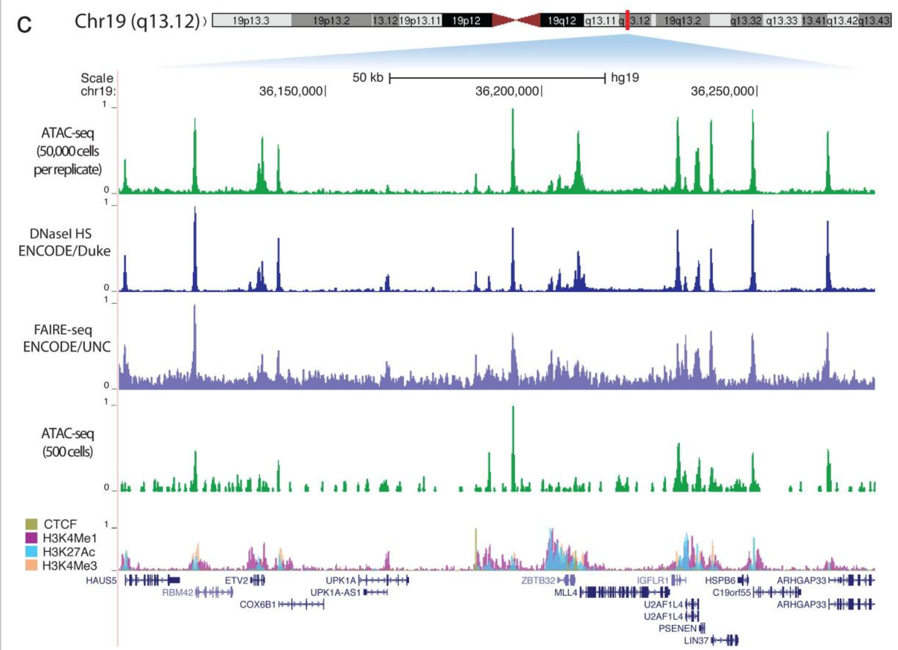
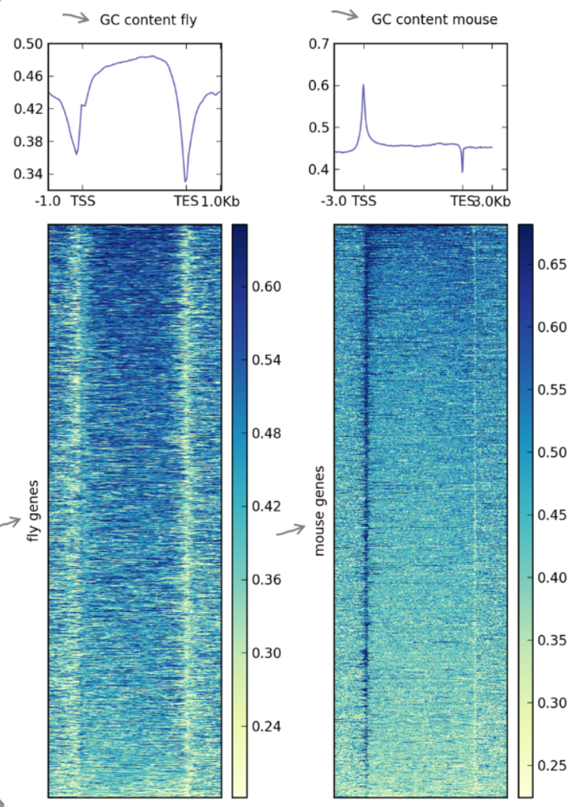

# Lab 10 - Genomic Visualization

## Objectives

- Learn about the common choices and strategies for normalization, and binning
when generating visualizations of genomic data
- Practice how you would dissect the intent of a figure, and how to go about
reproducing it with various levels of provided information

## How this lab works

For each example you are given a **working workflow** that reproduces a published
figure. You won't need to write or debug pipeline code. The work is in predicting,
reading, and reasoning.

1. **Run the workflow.** Start it first so that it runs while you discuss.
2. **Discuss and predict.** Decompose the figure, sketch how you would make it, and
predict the choices the authors made.
3. **Inspect the workflow.** Find which choices the workflow actually makes for the
important points raised in the questions, and compare them with your predictions.
4. **See the ramifications.** Look at your outputs and at variants made with
different choices. Which choices change the conclusion, and which only change how
the figure looks?
5. **Write it up.** Name the one choice that matters most for the figure's claim
and a sketch of how you would determine it.

## Decomposing a Figure

This next section is a series of questions you can apply to thinking about how
to reproduce any figure with some specifics related to our topic for today:
genomic visualization.

**Questions**
1. What is the intent of the figure? In one sentence, what are the authors trying
to convey?

2. What is the input data, and in what file format (BAM, bigwig, BED, FASTA, matrix)?
Where would you obtain it if needed?

3. What transformation produced the plotted values (binning, normalization, etc. )?

4. What tool would you use, and which parameters matter most?

5. What choices are hidden that impact the interpretation but are not obvious? (bin size, replicate merging)

6. Global or local? For each reference the figure relies on, is it computed from the whole genome/sample (global) or from the displayed window or neighborhood (local)?

7. Could this figure have come straight out of a browser, or did someone have to compute something first?

8. What would you need from the methods section to reproduce it exactly?

## Example 1: Genomic visualization of accessibility assays (Buenrostro et al 2013)



You have already seen this figure in the lecture on ATACseq, and now I'm going to
ask you how you would reproduce it and why they made the choices they did.

This particular figure was not exactly described in the methods and so it's a good
test case for thinking about all of the different assumptions and choices made
when visualizing sequencing data.

### Example 1: `bamCoverage` (BAM → bigwig)

Before you start, here is what the core deepTools step for each figure does at a
high level. Each one has defaults and options that may vastly influence the
representation of the underlying data.

```
bamCoverage -b sample.bam -o sample.bw --binSize 10 --normalizeUsing CPM --extendReads 200
```

- Splits the genome into bins of `--binSize` bp and counts the reads overlapping
  each bin.
- Optionally extends reads to the fragment length (`--extendReads`), skips
  duplicates or low-MAPQ reads, and smooths over neighboring bins (`--smoothLength`).
- Normalizes the counts (`--normalizeUsing`: `None`, `CPM`, `RPKM`, `BPM`, `RPGC`).
- The output is a bigwig of coverage values along the genome. None of the
  normalization options produces a value bounded at 0–1.

The above plot are bigWig representations of the read coverage from sequence
alignments. 

### Run the workflow

Run the workflow and then move to the discussion as it runs:

```bash
nextflow run bam_to_bigwig.nf -profile cluster,singularity
```

Don't open the workflow code yet. You'll inspect it after Part C.

### Part A: What is the figure trying to say?

1. In one sentence, what claim does this panel support?


2. Is this a quantitative or qualitative claim?


### Sketch the workflow

3. Describe in general terms what you would need to do to make this panel, from
raw data to the final figure. Hidden choices are choices that you may not be able
to determine directly from the figure.

| Step | What happens | Input | Output | Hidden choices |
|---|---|---|---|---|
| 1 | | | | |
| 2 | | | | |
| 3 | | | | |
| 4 | | | | |
| 5 | | | | |
| 6 | | | | |
| 7 | | | | |

Once you've filled in your sketch, compare it with the model sketch in
[`comparison/example1/model_sketch.md`](comparison/example1/model_sketch.md).

### Part B: Available information

4. What units are on each axis and what do they represent?

5. What does the axis scale of 0-1 imply for this figure?

6. Does the methods reveal how this figure was generated (https://pmc.ncbi.nlm.nih.gov/articles/PMC3959825/)?

7. What choices were made that are not easily determined from the figure alone?


### Part C: Thinking through the assumptions

8. List the ways you could produce a 0–1 axis from coverage data.

9. For each one, is the reference **global** (computed from the whole genome or
library) or **local** (computed from this window)?

10. Does any track's tallest peak reach exactly 1? Does every track's?

11. If each track had been scaled to its genome-wide maximum, what would you expect
an ordinary locus to look like?

12. How likely is it that the genome-wide maximum of three different assays falls
in this one window?

13. Read the text: how did the authors choose this locus?

14. Based on 10–13, which scaling does the evidence favor? How confident are you, and
could the figure alone settle it?

### Inspect the workflow

Now open `bam_to_bigwig.nf` (and its config). For each of the important points
raised above, note which choice the workflow made and where. If the workflow
doesn't make a choice explicitly, note what default it relies on.

| Choice | Related question(s) | Your prediction | What the workflow does | Where (process / line) |
|---|---|---|---|---|

| Bin size (`--binSize`) | 7 | | | |
| 0–1 scaling, and what it divides by | 8–14 | | | |
| Region the reference is computed over (window, chr19, genome) | 9, 14 | | | |


### Part D: Does it change the interpretation?

17. What *can* you conclude from this figure, and what can't you?

18. What does this scaling preserve within each track, and what does it lose between
tracks? Did changing the scaling change the *shape* of any track?

19. Would the conclusion look the same at a different locus? What would you need to
show to make the claim genome-wide?

20. Look at the paper, what did they do to follow-up on this figure?

### Part E: Strengthening the conclusion (hypotheticals)

The figure shows one locus. Suppose the authors wanted the claim "ATAC-seq has
signal-to-noise comparable to DNase-seq" to hold genome-wide, not just here.
Many of these approaches can be done with DeepTools if you want to look for
inspiration. You don't have to describe exactly how to implement it, just what
you might do at a high-level.

21. Pick one approach below. At a high level, what would you do, and which of the
new choices it introduces worries you most?

| Approach | What it fixes | New choices it introduces | Could they change the answer? |
|---|---|---|---|
| **Correlation between bigwigs** (`multiBigwigSummary` → `plotCorrelation`) | Locus dependence: compares assays everywhere at once, with no scaling to choose | Genome-wide bins vs. peak regions only; bin size; Pearson vs. Spearman; log transform; how zeros are handled | **Yes.** Genome-wide bins are mostly near-zero background, which can inflate agreement; Pearson is dominated by the tallest bins. Correlation at peaks asks a different question than correlation everywhere. |
| **Aggregate profile at a region set** (`computeMatrix` → `plotProfile`, e.g. at all DNase peaks or TSSs) | One locus → thousands; shows average peak-to-flank contrast | Which region set (whose peaks? defines the answer); flank size; normalization; mean vs. median | **Yes.** Using DNase peaks as the reference set favors DNase-like signal. |
| **Overlap with a reference peak set** (Venn/UpSet, or ROC against DNase peaks) | Sensitivity and specificity genome-wide | Reference set treated as truth; overlap definition (1 bp vs. 50%) | **Yes.** Treating DNase as ground truth assumes the thing being tested. |

### Part F: What would you need to reproduce it?

| What you need | What we know (and from where) | Still missing or assumed |
|---|---|---|
| | | |
| | | |
| | | |
| | | |
| | | |
| | | |
| | | |
| | | |

Once you've filled in your table, compare it with
[`comparison/example1/reproduce.md`](comparison/example1/reproduce.md).

### Visualizing these tracks on the SCC

1. Go to the interactive apps tab and choose the `Desktop` option.

2. Note the path to your repository's `results/` folder; you'll browse to it when
loading local files.

3. Open the web browser from the dock at the bottom and navigate to `igv.org`

4. To get started, you can simply choose from the `Genome` tab the appropriate genome.
For this first example, it will be `hg19`.

5. Next, use the `Tracks` tab and use `Local File` to load the bigwigs that were
generated from the pipeline along with the narrowPeaks files in the reference/
directory.

### Write it up

22. Name the one choice that matters most for this figure's claim, and explain why.

23. Sketch how you would determine that choice if you were reproducing the figure
yourself. Answer in plain words: **where** would you get the data, **what format**
is it in, and **what would you calculate**? 


## Example 2: GC/AT content near promoters across species



This figure was generated from the genomic sequence and shows a characteristic
difference in GC content relative to the gene bodies in different species.

### Example 2: `computeMatrix` (bigwig + regions → matrix)

```
computeMatrix scale-regions -S GCcontent.bw -R genes.bed \
  --regionBodyLength 5000 -b 3000 -a 3000 --binSize 50 -o matrix.gz
```

- Takes a signal track (bigwig) and a set of regions (BED/GTF) and pulls out the
  signal over each region, binned into a genes × bins matrix.
- In `reference-point` mode, every region is anchored at one point (e.g. the TSS)
  and the flanks are measured in real base pairs.
- In `scale-regions` mode, every gene body is stretched or compressed to the same
  length (`--regionBodyLength`), with fixed-size flanks (`-b`/`-a`) on either side.
- The matrix is then summarized by `plotProfile` (average across genes) or
  `plotHeatmap` (one row per gene).

### Run the workflow

Run the workflow and then move to discussing or answering the questions that follow:

```bash
nextflow run compute_matrix.nf -profile singularity,cluster
```

Don't open the workflow code yet. You'll inspect it later.

### Part A: What is the figure trying to say?

1. In one sentence, what claim does this figure support?


2. Is this a quantitative or qualitative claim?


### Sketch the workflow

3. Describe in general terms what you would need to do to make this figure, from
genome sequence to the final heatmap or profile. Aim for 4–7 steps, and list the
choices hidden in each.

| Step | What happens | Input | Output | Hidden choices |
|---|---|---|---|---|
| 1 | | | | |
| 2 | | | | |
| 3 | | | | |
| 4 | | | | |
| 5 | | | | |
| 6 | | | | |
| 7 | | | | |

Once you've filled in your sketch, compare it with the model sketch in
[`comparison/example2/model_sketch.md`](comparison/example2/model_sketch.md).

### Part B: Available information

4. What quantity is on the y-axis: a fraction, a percent, or something else?

5. What's the theoretical range of that quantity?

6. Are the y-axis ranges the same in the two species' panels? Does this affect
our interpretation of the figure?

7. Which regions do you think were used for this figure?


### Part C: Thinking through the assumptions

8. Look up each genome's overall GC content. Where does that baseline fall on each
panel?

9. Is the promoter "GC-rich" compared with the whole genome, or compared with its
own neighborhood?

10. What information are you missing about how to reproduce this figure?

### Inspect the workflow

Now open `compute_matrix.nf` (and its config). For each of the important points
raised above, note which choice the workflow made and where. If the workflow
doesn't make a choice explicitly, note what default it relies on.

| Choice | Related question(s) | Your prediction | What the workflow does | Where (process / line) |
|---|---|---|---|---|
| GC track source and window size | 4, 5, 8 | | | |
| Gene set and one transcript per gene | 7 | | | |
| `computeMatrix` mode | 7, 11 | | | |
| Body length per species (`--regionBodyLength`) | 11 | | | |
| Flanks per species (`-b` / `-a`) | 11 | | | |
| Bin size (`--binSize`) | 11 | | | |


### Part D: Does it change the interpretation?

Look at your outputs in `results/`, and at the variants your instructor shows
with different bin sizes, and body length scaling.

14. Which choices changed the *shape* of the profile, and which only changed its
height or smoothness?

15. In Example 1, changing the scaling didn't change the shape of any track. Here,
changing the bin size and body length did. What's different about these
transformations?

16. The GC track has 5 bp resolution. What does a profile with a 5 bp bin show? What
would a 1 bp bin show?

17. When fly gene bodies are stretched to mouse's body length, does the profile look
more or less detailed? Is that detail real?

18. How do you think the values for flanking (1k for dm6, 3k for mm10) were chosen?

### Part E: Comparing the species fairly (hypotheticals)

Suppose the authors wanted to claim that mouse promoters are more GC-enriched than
fly promoters. As in Example 1, describe what you might do at a high level.

19. The two panels use different y-axis and color ranges. What would you change so
the species can be compared by eye, and what would that hide?

20. Each genome has a different baseline GC content. How would you make "enriched"
mean the same thing in both species?

21. With `scale-regions`, the x-axis is gene-relative and differs between species.
A CpG island has roughly the same physical size in both. How could you compare the
TSS region in real base pairs? (Hint: `reference-point` mode, or an unscaled region
at the TSS.)

### Part F: What would you need to reproduce it?

| What you need | What we know (and from where) | Still missing or assumed |
|---|---|---|
| | | |
| | | |
| | | |
| | | |
| | | |
| | | |
| | | |
| | | |

Once you've filled in your table, compare it with
[`comparison/example2/reproduce.md`](comparison/example2/reproduce.md).

### Write it up

22. Name the one choice that matters most for comparing the two species, and
explain why.

23. Sketch how you would determine that choice if you were reproducing the figure
yourself: **where** would you get the data, **what format** is it in, and **what
would you calculate**?